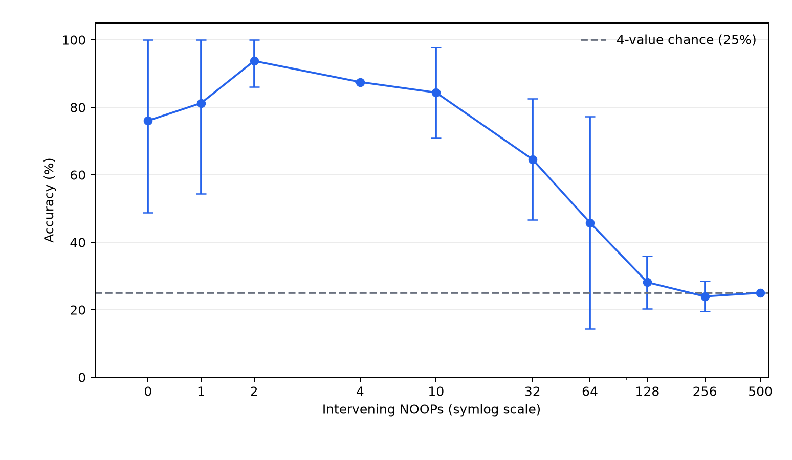
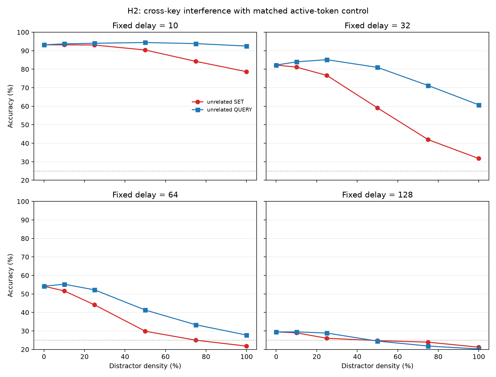
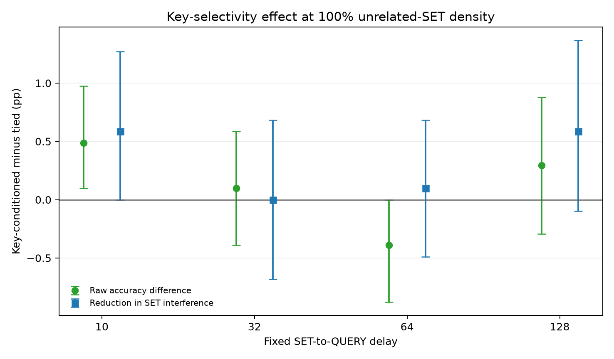

# Long-Horizon State Tracking with a Compact Mamba

**HackerRank DL Research Engineer assignment — final report**
**Primary run:** seed 42; supplementary baseline diagnostics use seeds 42–46

## Executive summary

I implemented the specified one-layer Mamba state tracker, trained it on the supplied length-32–128 data, and evaluated it on the fixed in-distribution (ID), out-of-distribution (OOD), delay-stress, and overwrite-stress splits. The 300-update baseline was undertrained, so I extended the same run to 1,500 updates using validation accuracy only. The resulting model reached 75.05% at length 128 and 69.64% at length 512, but controlled probes exposed a much larger dependency-length failure: accuracy fell from 84.38% at delay 10 to 28.13% at delay 128 and chance (25%) at delay 500 across three seeds.

Part B tests whether unrelated-key writes collide in shared recurrent coordinates. I add a learned key-conditioned soft routing vector to the selective-scan input-write term and compare it with a parameter-matched tied-row control. The proposed model makes small aggregate gains over the baseline, but improves over its tied control by only 0.05–0.12 percentage points on fixed splits and by less than one point on the controlled interference test. Its routing rows are also almost identical (mean pairwise cosine similarity 0.99958). The mechanism-specific hypothesis is therefore falsified for this run: extra capacity or globally reduced writes, not key selectivity, explains the gains.

Mechanistic diagnostics support accumulated recurrent transition error as the primary bottleneck. After allowing the width-4 convolution three steps to finish responding to a SET, forcing the remaining NOOP recurrent transitions to identity raises accuracy to about 97% through delay 128. However, a frozen long-horizon readout experiment also shows that preserved information is not automatically usable by the original classifier. The most promising next step is consequently a learned, convolution-aware no-update transition combined with a readout trained to remain stable across retention regimes.

## 1. Architecture

The task has eight keys, four assigned values, and three event types. The 41 logical input tokens are one NOOP token, 32 `SET(key,value)` tokens, and eight `QUERY(key)` tokens; the embedding table is padded to 48 entries for the Mamba implementation. A query target is class 0 (`UNSET`) or classes 1–4. The queried answer is never encoded in the input token.

The fixed backbone is exactly the requested compact configuration: `d_model=32`, one Mamba block, `d_state=8`, expansion factor 2 (`d_inner=64`), and causal depthwise convolution width 4. A `Linear(32,5)` head produces one class distribution per timestep. With batch size (B) and length (L), inputs have shape (B\times L), backbone features (B\times L\times32), logits (B\times L\times5), and the recurrent SSM state (B\times64\times8). The baseline has 10,149 trainable parameters.

For convolution-processed input (u_t), the readable selective scan computes input-dependent Δ, (B_t), and (C_t), with (A=-\exp(A_{\log})<0):

\[
h_t=\exp(\Delta_t A)\odot h_{t-1}+\Delta_t B_tu_t,
\qquad
r_t=C_t h_t+D\odot u_t.
\]

The output gate and projection then map the 64-dimensional scan output to the 32-dimensional final feature. This implementation makes the relevant asymmetry explicit. Retention depends on repeatedly multiplying by (\exp(\Delta_t A)); overwrite requires a new write and an appropriate query-dependent readout; unrelated events can both attenuate existing state and add competing writes. Thus NOOP delay and cross-key SET interference need not have the same effect.

The causal convolution is left-padded, and the scan is a left-to-right recurrence. Targets are set to `-100` at non-query positions, and cross-entropy uses `ignore_index=-100`; only QUERY positions contribute to the objective. The dataset loader checks lengths, token ranges, and target placement. Automated tests cover the exact dictionary oracle, UNSET queries, overwrite semantics, NOOP invariance of the symbolic state, query masking/no target leakage, tensor shape and finiteness, gradients, causality, and the behavior of modified routing. All 33 tests pass.

## 2. Hypotheses

**H1 — long-horizon retention degradation.** For a fixed assignment, increasing the number of intervening NOOPs reduces QUERY accuracy because the recurrence does not preserve a sufficiently decodable representation. It is falsified if long-delay accuracy is statistically indistinguishable from, or exceeds, short-delay accuracy with precise estimates.

**H2 — cross-key interference.** At fixed SET-to-QUERY delay, replacing NOOPs with SETs to unrelated keys reduces accuracy more than replacing them with unrelated QUERYs. It is falsified if the paired SET-minus-QUERY or SET-minus-NOOP effect is not negative over the model’s usable accuracy range.

**Part B mechanism — key-conditioned write isolation.** If H2 arises because keys write into overlapping recurrent coordinates, key-conditioned routing of (\Delta_tB_tu_t) should outperform a parameter-matched key-agnostic router on matched interference examples. The predeclared practical criterion is at least a 2-point improvement at high distractor density; failure to beat the tied control falsifies this proposed mechanism.

## 3. Method

I used the supplied generator and fixed sample splits without changing examples: 4,000 training sequences and 500 validation sequences of length 32–128; 500-example ID-128, OOD-256, OOD-512, delay-stress-512, and overwrite-stress-512 test files. Training used random initialization, FP32 AdamW, learning rate 0.001, and batch size 16. The exact dictionary simulator provides a 100% oracle and an implementation check. The constant and training-majority baselines are identical because `UNSET` is the majority training class.

The initial baseline was evaluated after 300 updates, as requested. Because it had only 25.67% ID accuracy and failed an immediate-recall prerequisite, I resumed the same model and optimizer to 600, 1,000, and 1,500 updates. These checkpoints achieved 54.78%, 67.70%, and 79.20% validation accuracy; I selected 1,500 updates without consulting test metrics. Proposed and ablation models received the same 1,500-update budget and fixed evaluation data.

For H1, each of three independently trained baselines (seeds 42–44) was tested on balanced combinations of eight keys and four values, with delays 10, 32, 64, 128, 256, and 500. For H2, five baselines (seeds 42–46) saw 1,024 paired examples per condition. At a fixed delay, distractor density is the fraction of intervening slots occupied by unrelated-key SETs; matched controls replace these with NOOPs or unrelated QUERYs. Confidence intervals use paired or hierarchical bootstrap resampling where paired predictions are available; seed-level H1 intervals use the (t) distribution and should be treated cautiously because (n=3).

### Part B modification and ablation

The proposed model learns (R\in\mathbb{R}^{8\times64}). For a SET to key (k), (r_k=\sigma(R_k)) gates the write:

\[
h_t=\exp(\Delta_t A)\odot h_{t-1}
 +r_k\odot\Delta_tB_tu_t.
\]

Non-SET writes are unchanged. This adds 512 parameters (10,661 total, +5.0%). The tied-row ablation retains the same (8\times64) parameter table but averages its rows during computation, eliminating key selectivity while matching nominal capacity and almost all computation. Both are initialized with gate value 0.95 so neither begins by suppressing most writes.

## 4. Results

### Baseline and sequence length

| Fixed split | Length | 300 updates | 1,500 updates | Always UNSET | Oracle |
|---|---:|---:|---:|---:|---:|
| ID | 128 | 25.67% | **75.05%** | 23.28% | 100% |
| OOD | 256 | 14.81% | **71.23%** | 11.28% | 100% |
| OOD | 512 | 10.45% | **69.64%** | 5.97% | 100% |
| Delay stress, all queries | 512 | 8.64% | **69.59%** | 4.21% | 100% |
| Overwrite stress, all queries | 512 | 8.86% | **69.67%** | 4.28% | 100% |

The aggregate 512 results are substantially above the non-neural baseline, but aggregate accuracy hides the final long-dependency probe. H1 makes this distinction visible. Mean balanced retrieval accuracy across seeds 42–44 was 84.38%, 64.58%, 45.83%, 28.13%, 23.96%, and 25.00% at delays 10, 32, 64, 128, 256, and 500. The paired drop from delay 10 to 128 was 56.25 points (95% seed-level CI 40.72–71.78), and the drop to 500 was 59.38 points (45.93–72.82). H1 is supported.



### Cross-key interference

For five baselines, NOOP accuracy at delays 10/32/64/128 was 93.16/82.23/54.16/29.47%. With every intervening slot replaced by an unrelated SET, it was 78.67/31.74/21.80/21.21%. The corresponding SET-minus-NOOP effects were −14.49, −50.49, −32.36, and −8.26 points. Unrelated QUERY controls remain much stronger than SET distractors at the intermediate delays, ruling out a simple “any non-NOOP token” explanation. H2 is therefore supported where baseline accuracy is above the chance floor; the smaller delay-128 effect is floor-limited, not evidence of recovery.



### Part B fixed-split comparison

| Model | ID-128 | OOD-256 | OOD-512 | Delay stress | Overwrite stress |
|---|---:|---:|---:|---:|---:|
| Baseline | 75.05% | 71.23% | 69.64% | 69.59% | **69.67%** |
| Key-conditioned routing | **75.57%** | **71.54%** | **69.86%** | **70.06%** | 69.55% |
| Tied routing | 75.50% | 71.42% | 69.75% | 69.96% | 69.50% |

The proposed model’s advantage over the matched ablation is only +0.07, +0.12, +0.11, +0.10, and +0.05 points respectively. On the primary controlled H2 test at 100% SET density, proposed-minus-tied effects at delays 10/32/64/128 are +0.49, +0.10, −0.39, and +0.29 points; every interval includes effects below the predeclared 2-point threshold. The Part B mechanism is not supported.

The matched isolated-retention breakdown also fails to separate key selectivity from its control:

| SET-to-QUERY delay | Baseline | Key-conditioned | Tied routing |
|---:|---:|---:|---:|
| 10 | 88.96% | 93.36% | 93.36% |
| 32 | 82.13% | 84.08% | **84.18%** |
| 64 | **63.18%** | 59.86% | 60.16% |
| 128 | 33.50% | 38.09% | **38.77%** |

The routed models’ apparent delay-128 gain is reproduced—and slightly exceeded—by the tied control, while both are worse than baseline at delay 64. It therefore cannot be credited to key-specific isolation.

The learned router provides a mechanistic check on this negative result. Its mean gate is 0.946, mean normalized pairwise row distance is only 0.0286, and mean pairwise cosine similarity is 0.99958. The network learned a nearly global write rescaling, not eight separated channel-use patterns.



The assignment overwrite probe shows the same lack of separation. Accuracy at the final query, grouped by the designed number of focus-key overwrites, is:

| Focus-key overwrites | Baseline | Key-conditioned | Tied routing |
|---:|---:|---:|---:|
| 1 | 88.8% | 90.4% | 90.4% |
| 2 | **88.0%** | 87.2% | 87.2% |
| 4 | **82.4%** | 80.8% | 80.8% |
| 8 | 90.4% | 91.2% | **92.0%** |

Each cell contains 125 fixed probes. The non-monotonic curve means overwrite count is not an isolated difficulty axis in these generated sequences; it must not be read as evidence that eight overwrites are intrinsically easier than four. Stale-value error over all 500 final overwrite probes is 8.6% for baseline, 9.0% for key-conditioned routing, and 8.8% for tied routing. Thus routing does not improve obsolete-value rejection either.

### Cost and reproducibility

| Model | Parameters | Updates | Train time | Peak GPU memory | Validation throughput |
|---|---:|---:|---:|---:|---:|
| Baseline | 10,149 | 1,500 | 449.6 s | 50.7 MiB | 3,335 queries/s |
| Key-conditioned | 10,661 | 1,500 | 953.6 s | 55.2 MiB | 2,955 queries/s |
| Tied routing | 10,661 | 1,500 | 1,162.3 s | 55.2 MiB | 2,768 queries/s |

All runs used an NVIDIA GeForce GTX 1650 in FP32. The +512 parameters and +4.5 MiB peak allocation are modest, but the readable per-position routing path is not optimized and roughly doubles wall time. Timing noise explains why the nominally matched tied model was slower; no throughput advantage is claimed.

## 5. Ablation and failure analysis

The tied-row ablation is decisive for the Part B claim. Both routed models improve slightly over the baseline, but they are practically indistinguishable from each other. Because the tied model cannot use key identity, the improvement cannot be attributed to memory isolation. Key routing also leaves two major routes for interference untouched: unrelated events still multiply all recurrent coordinates by (\exp(\Delta_tA)), and upstream/downstream projections remain shared.

The strongest controlled diagnostic targets the first route. Abruptly forcing identity immediately after SET destroys performance because the width-4 convolution is still writing for three subsequent timesteps. After this three-step washout, however, an oracle intervention that makes later NOOP recurrent transitions identity yields 96.84%, 96.70%, 97.05%, and 96.60% at delays 10, 32, 64, and 128 across five seeds, versus 93.36%, 81.15%, 54.47%, and 29.32% normally. This supports a refined conclusion: late passive transitions introduce damaging accumulated change, while the early post-SET response is functionally necessary.

Nonzero hidden movement alone is not an error, and these interventions are out of distribution. I therefore also tested decodability rather than interpreting state drift directly. On a balanced 511-step diagnostic, setting the late-NOOP decay multiplier to zero leaves the original head at 25.8%, but a separately trained linear head on the same frozen 32-dimensional long-horizon features reaches 99.6%. A short-horizon-only retrained head does not reproduce this gain. This shows a second bottleneck under modified dynamics: preserved features undergo a horizon/decay-dependent distribution shift that the original short-trained classifier cannot use. It is diagnostic decodability, not a fair replacement model, because the 99.6% head receives supervised length-511 examples.

Taken together, the evidence ranks the bottlenecks as follows. Accumulated transition/retention error is primary: it explains the steep controlled delay curve and the large delayed-identity rescue. Cross-key writes matter observationally, but suppressing or routing only their write term does not deliver a robust solution. Readout mismatch becomes important once retention dynamics are changed; improving preservation alone need not improve task accuracy.

### Supplementary gate-free adaptive-kernel diagnostic

To isolate local convolutional mixing, I retrained original fixed-width-4 Mamba, fixed width 8, a static mixture over effective widths \(\{1,2,4,8\}\), and a token-conditioned adaptive mixture. No model in this comparison contains an event-conditioned retention gate. Static and adaptive mixtures are parameter matched at 10,729 parameters and use the same 1,500-update seed-42 budget. Adaptive achieves the best aggregate OOD-512, delay-stress, and overwrite-stress accuracy (73.91%, 73.58%, and 73.98%), but it does not beat static on the designed final probes: 23.2% versus 24.4% after the 511-step gap and 92.4% versus 93.4% after overwrites. Paired adaptive-minus-static effects are -1.2 points (95% CI -5.6 to 3.0) and -1.0 point (-3.2 to 1.2). The router genuinely adapts its expected width (7.99/6.16/7.55 for NOOP/SET/QUERY), yet the targeted results do not support input-dependent kernel selection over static mixing, and all variants remain near chance on extreme retention. Adaptive training takes 1,096.4 s versus 656.6 s for static and 449.6 s for original, while peak GPU allocation rises only from 50.7 MiB to 54.8 MiB; its dominant engineering cost is runtime rather than memory.

## 6. Limitations and next steps

The proposed/ablation comparison is one training seed, so very small optimization effects remain uncertain. This does not rescue the claimed mechanism: observed effects are far below the 2-point practical threshold, the router itself does not specialize, and matched controls explain the aggregate gains. H1 uses only three model seeds and small balanced key–value grids; its intervals are accordingly wide. Several mechanistic interventions alter a frozen model’s hidden-state distribution and cannot be presented as deployable architectures. Finally, the Python reference scan emphasizes clarity rather than kernel-level efficiency, so wall-clock costs do not predict an optimized implementation.

If given one more week, I would run one focused experiment: train a **convolution-aware no-update gate** that leaves the first (d_{conv}-1=3) post-SET transitions unconstrained, then learns to interpolate later NOOP recurrence between the ordinary transition and identity. I would jointly add consistency of the original five-class readout across two mild retention perturbations on the same length-32–128 sequence. The comparison would use baseline, gated model, and a parameter-matched event-agnostic gate across at least five seeds, with no supervised length-511 examples. Primary outcomes would be untouched final-probe accuracy at delays 128/256/511, immediate overwrite accuracy and stale-value error, plus fixed-split accuracy and runtime. It would be falsified if it merely improves short-horizon transition geometry while length-511 accuracy remains near chance, or if retention gains cause a material overwrite penalty. This directly tests whether the causal bottleneck identified here can be corrected without sacrificing forgetting or relying on long-horizon labels.

## Reproducibility and attribution

The core commands are:

```powershell
uv sync --all-groups
.\.venv\Scripts\python.exe train.py --config configs\baseline.yaml --seed 42 --max-updates 1500 --device cuda
.\.venv\Scripts\python.exe train.py --config configs\proposed.yaml --seed 42 --max-updates 1500 --device cuda
.\.venv\Scripts\python.exe train.py --config configs\ablation.yaml --seed 42 --max-updates 1500 --device cuda
.\.venv\Scripts\python.exe part_b_compare.py --device cuda
.\.venv\Scripts\python.exe train.py --config configs\baseline_conv8.yaml --output-dir results\adaptive_kernel_kernel_only\seed42\fixed8\u1500 --max-updates 1500 --device cuda
.\.venv\Scripts\python.exe train.py --config configs\static_kernel_mix_only.yaml --output-dir results\adaptive_kernel_kernel_only\seed42\static\u1500 --max-updates 1500 --device cuda
.\.venv\Scripts\python.exe train.py --config configs\adaptive_kernel_only.yaml --output-dir results\adaptive_kernel_kernel_only\seed42\adaptive\u1500 --max-updates 1500 --device cuda
.\.venv\Scripts\python.exe adaptive_kernel_compare.py --device cuda
.\.venv\Scripts\python.exe assignment_stress_evaluation.py --device cuda
.\.venv\Scripts\python.exe -m pytest -q -p no:cacheprovider
```

The project includes a CPU path (`--device cpu`); for a time-limited Colab CPU smoke run, reduce updates and optionally use `d_model=16,d_state=4`, clearly labeling it as a non-comparable fallback. Machine-readable predictions, confidence intervals, plots, and checkpoints are under `results/`. The full exploratory record is retained in `research_notes_full.md`.

The readable Mamba implementation derives from John Ma’s MIT-licensed `mamba-minimal`; architecture equations follow Gu and Dao’s Mamba paper. The assignment generator and sample data were supplied with the task. AI assistance was used substantially for implementation scaffolding, experiment scripting, plotting, and report editing. I inspected the code paths, selected the hypotheses and controls, ran the experiments, checked saved artifacts, and take responsibility for the conclusions. No result from an external implementation is reported as an original measurement.

**Primary references:** A. Gu and T. Dao, *Mamba: Linear-Time Sequence Modeling with Selective State Spaces* (2023); J. Ma, *mamba-minimal* (MIT License).
